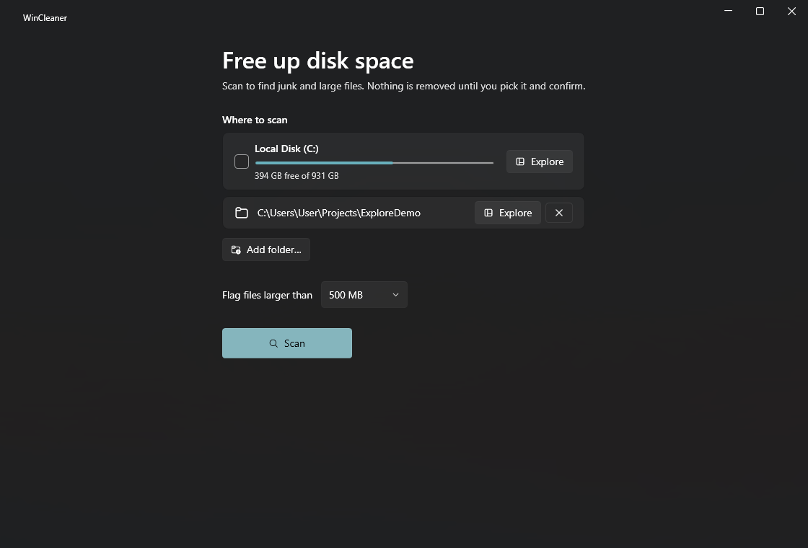
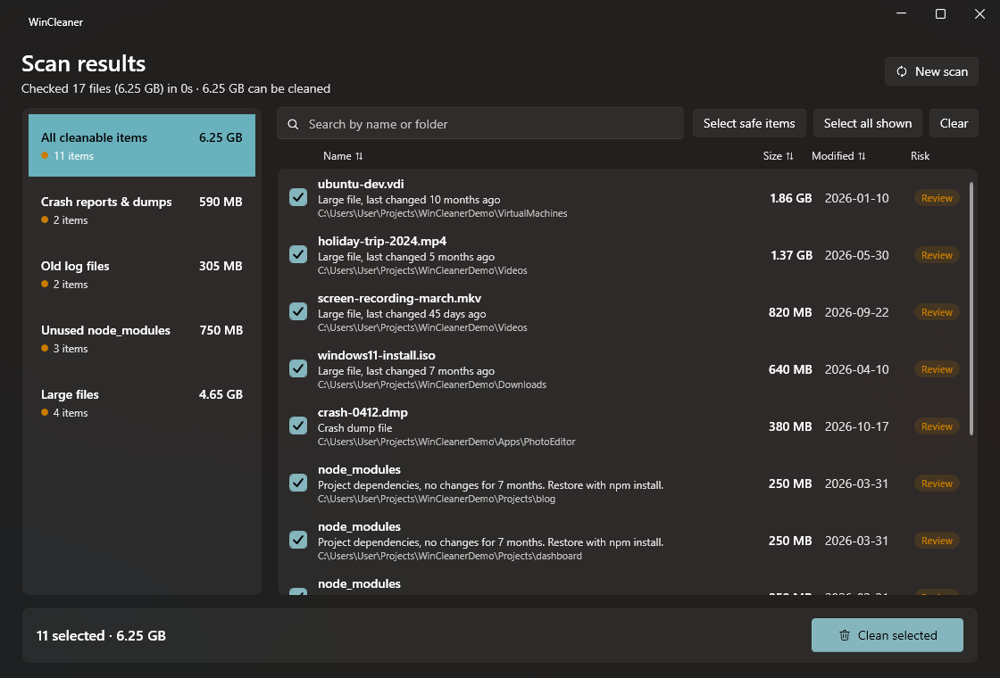
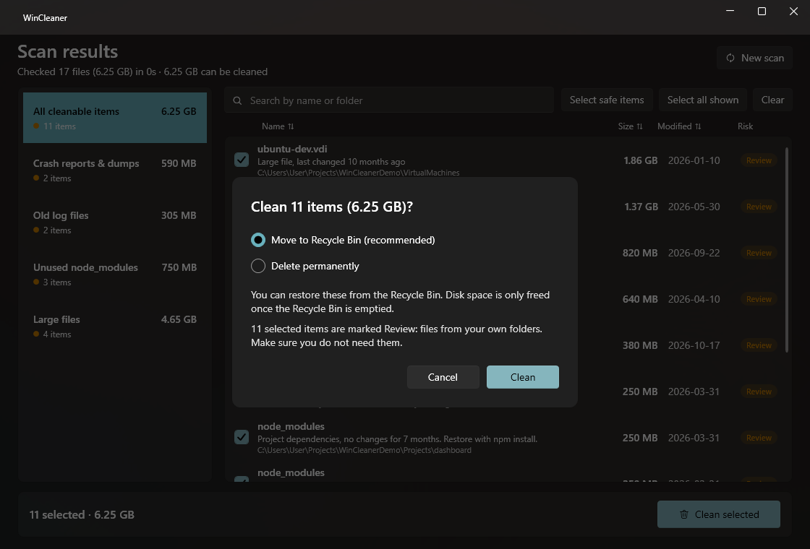
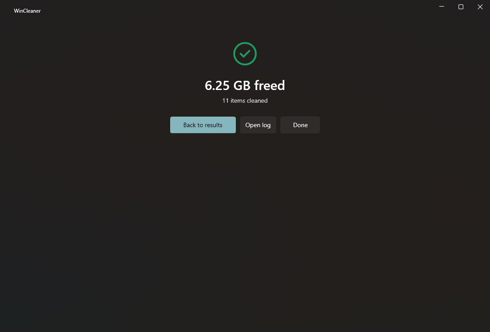
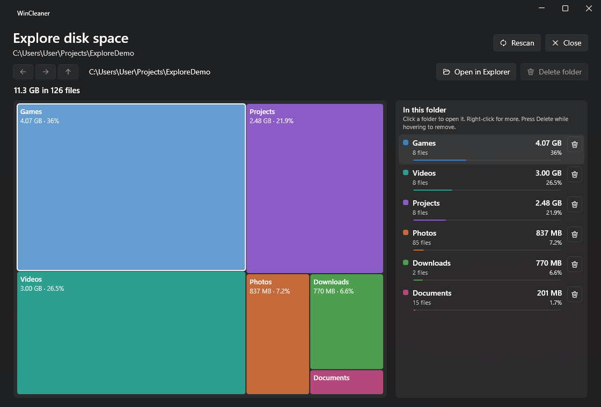
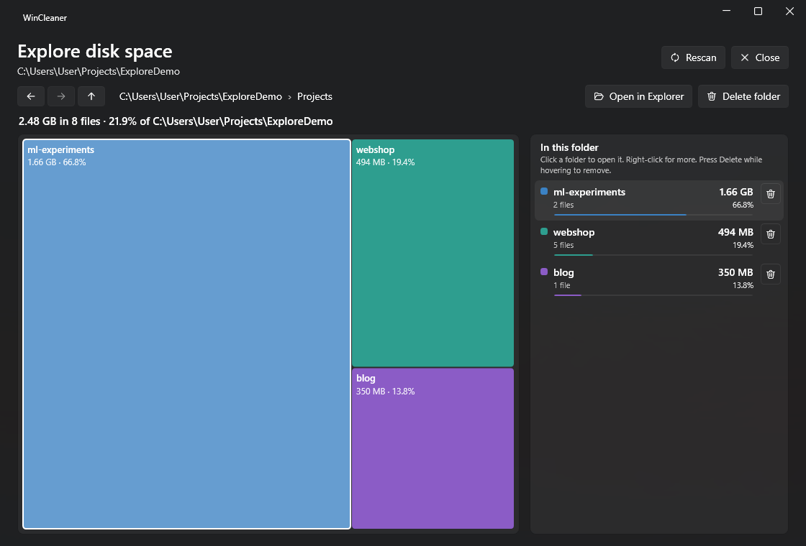
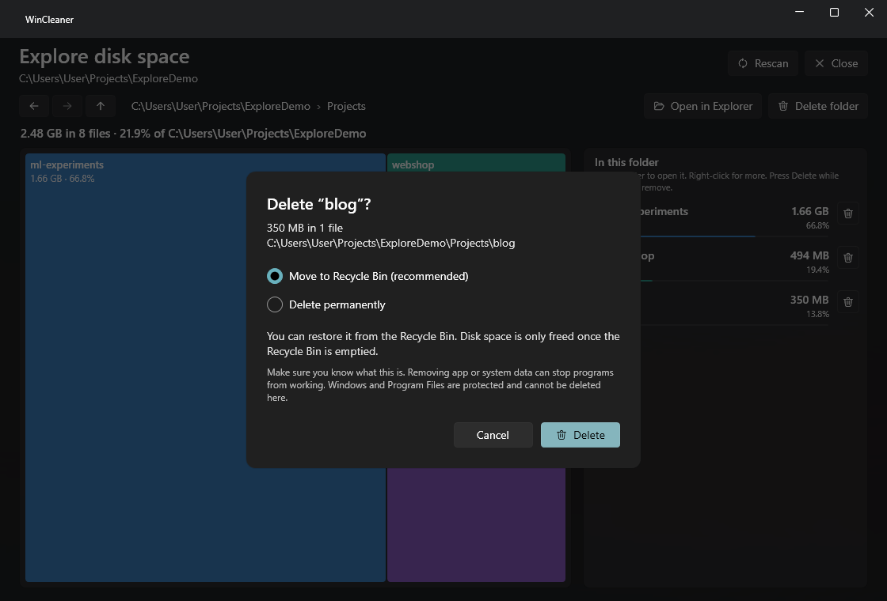

<p align="center">
  
</p>

# WinCleaner

A small, modern Windows storage cleaner. It scans your drives (or any folders you pick), finds junk and large
files, and lets you choose exactly what to remove. It can also **map where your space went**: an interactive
treemap of every folder that you can click through level by level. **Scanning is read-only. Nothing is deleted
until you pick it and confirm.**

## Screenshots

Pick what to scan, review the results, then confirm. (Shown with demo data.)

| | |
|---|---|
|  |  |
|  |  |

### Explore disk space

| | |
|---|---|
|  |  |
|  | |

## Explore disk space

Click **Explore** on any drive or folder on the home screen. WinCleaner maps the folder tree once (a few seconds
for a whole drive), then you can move around instantly:

- **Treemap:** every block is a folder or file, and its area is its size. Hover for details; the matching row in
  the list on the right lights up too.
- **Go deeper:** click a folder block (or its row) to open it. Folders are colour-coded, files are grey.
- **Go back easily:** Back / Forward / Up buttons, a clickable breadcrumb path, `Alt+Left`, `Alt+Right`,
  `Alt+Up` or `Backspace`, and the mouse back/forward buttons.
- **Delete from the map:** use the trash button on a row, right-click a block or row, press `Delete` while
  hovering, or use **Delete folder** to remove the folder you are in. You always get a confirm dialog (Recycle Bin
  by default). Sizes and the treemap update straight away; no rescan needed.
- **Also:** open any item in Windows Explorer, and **Rescan** to pick up changes made elsewhere.

Deleting here goes through the same safety checks as the cleaner: Windows, Program Files, ProgramData, system
files, other users' profiles and the approved cache folders themselves can never be deleted (their trash buttons
are disabled and explain why), junctions and symlinks are never followed, and every action is logged.
Sizes are file sizes, not space allocated on disk, and cloud-only (OneDrive-style) files are not counted.

## Run it

Requires Windows 10/11 (x64). Build it (see [Build from source](#build-from-source)), then run
`publish\WinCleaner.exe`. It needs the [.NET 8 Desktop Runtime](https://dotnet.microsoft.com/download/dotnet/8.0).

You can also pass folders to scan instead of the system drive: `WinCleaner.exe D:\Games "C:\Users\me\Videos"`.

## What it finds

| Category | Examples | Risk |
|---|---|---|
| Temporary files | user and Windows temp folders, only if untouched for 24 h | Safe |
| Browser caches | Chrome, Edge, Brave, Firefox caches (never profiles, cookies or passwords) | Safe |
| App and developer caches | shader caches, npm, pip, NuGet HTTP cache, Internet cache | Safe |
| Crash reports and dumps | CrashDumps, WER, Minidump (plus loose `.dmp` files, as Review) | Safe / Review |
| Windows Update downloads | `SoftwareDistribution\Download` | Safe |
| Recycle Bin | emptied permanently | Safe |
| Old log files | `.log` / `.etl` over 1 MB, not modified for 30 days | Review |
| Old downloads | installers and archives in Downloads, untouched for 90 days | Review |
| Unused `node_modules` | whole folder as one item, no changes for 90 days | Review |
| Large files | anything over your chosen size (default 500 MB) | Review |

Items marked **Locked** are shown so you can see what uses space, but cannot be selected: Windows, Program Files,
ProgramData, `pagefile.sys` / `hiberfil.sys` / `swapfile.sys`, files with the System attribute, other users'
profiles.

**Review** items live in your own folders (for example a model file in a project). They are never pre-selected.
"Select safe items" only ticks the Safe ones.

Some Windows items (Windows temp, Windows Update downloads) need administrator rights. Use
**Restart as administrator** in the results screen to include them.

## How deletion stays safe

- The default is **Move to Recycle Bin**. Permanent delete is an explicit choice in the confirm dialog.
- Before each item is removed it is re-checked: still the same size and modified time as in the scan, not a
  protected path (case, `..`, `\\?\` and 8.3 tricks are normalised), and no junction or symlink anywhere in the
  path. A changed or suspicious item is skipped and reported.
- Junctions and symlinks are never followed, when scanning or deleting. Deleting a folder that contains one
  removes the link only, never what it points to.
- OneDrive-style cloud-only placeholders are ignored.
- A file that is in use is skipped and listed; the rest of the run continues.
- Every action is logged to `%LOCALAPPDATA%\WinCleaner\clean-log.txt`.
- Recycled files only free space once you empty the Recycle Bin. A drive with no Recycle Bin (such as a USB stick)
  refuses "Move to Recycle Bin" rather than silently deleting.

## Build from source

```
dotnet build
dotnet test
dotnet publish src/WinCleaner.App -c Release -r win-x64 --self-contained false -p:PublishSingleFile=true -o publish
```

Layout: `src/WinCleaner.Core` (rules, scanner, cleaner, folder-tree scanner, treemap layout; no UI),
`src/WinCleaner.App` (WPF + WPF-UI, MVVM; `Controls/TreemapControl.cs` draws the treemap),
`tests/WinCleaner.Tests` (57 tests that run against throwaway sandbox folders and never touch real files).

## Notes

- Windows x64 only.
- .NET 8 reaches end of support on 10 Nov 2026. The app makes no network connections, but you may want to
  retarget to a newer .NET LTS later (change `TargetFramework`, install that runtime).
- Duplicate-file detection is not included.
